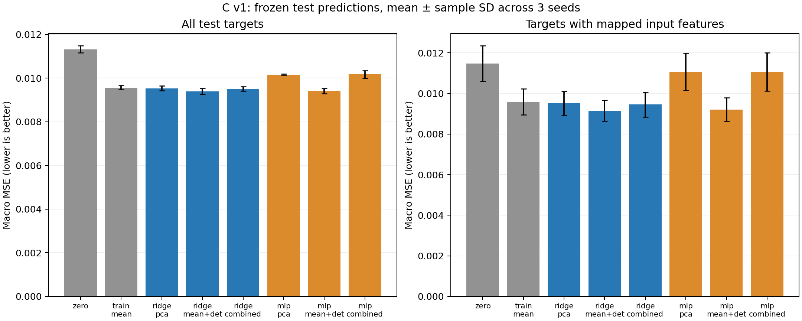

# C 主模型实验结果

状态：C 的特征、Ridge/MLP、三种表示消融、三种子训练、冻结预测和诊断评估已经完成。以下为本项目实际运行结果；尚未包含 A 的参考方法或 D 的独立验收。

实验目录：`results/c_v1_20261106`。冻结时间：`2026-11-06T10:21:49.440272+00:00`；独立评估进程完成时间：`2026-11-06T10:26:25.500177+00:00`。

## 数据和评价对象

沿用已核验的 GEARS 5000 基因版本与 B v0.1 接口，目标级划分种子为 42、123、2026。每个 seed 有 760/162/164 个 train/val/test 目标；可唯一映射到输入列的训练目标为 284/279/302，测试目标为 66/73/59。

PCA 仅使用各 seed 的 7483 个训练对照，按基因中心化、不按方差缩放、不 whitening；取 `components_.T` 作为 50 维基因表示，追加源 X 均值与正值比例。标准化仅用可映射的训练目标拟合。缺少输入列的目标统一使用所有训练目标的等权平均 delta 回退。

## 冻结测试结果

以下均为三个种子的算术平均 ± 样本标准差。MSE 降低率相对于训练均值基线，正数表示误差下降，负数表示误差上升。残差相关是减去训练均值后的 Pearson，不是 DRF。

| 方法 | 全部目标 MSE | 可映射目标 MSE | 全部 MSE 降低率 | 可映射 MSE 降低率 | 可映射残差 Pearson |
|---|---:|---:|---:|---:|---:|
| zero | 0.01132 ± 0.000162218 | 0.0114693 ± 0.000880391 | -18.27% | -19.49% | 0.0935048 |
| train_mean | 0.00957154 ± 9.25314e-05 | 0.0095984 ± 0.000640136 | 0.00% | 0.00% | NA |
| ridge_pca | 0.00953648 ± 0.000113539 | 0.00951187 ± 0.000585258 | 0.37% | 0.90% | 0.18768 |
| ridge_mean_detection | 0.00939214 ± 0.000141067 | 0.00915205 ± 0.000519867 | 1.87% | 4.65% | 0.120138 |
| ridge_combined | 0.00951412 ± 0.000106485 | 0.00945359 ± 0.00061393 | 0.60% | 1.51% | 0.194806 |
| mlp_pca | 0.0101626 ± 2.35867e-05 | 0.0110787 ± 0.000917318 | -6.18% | -15.42% | 0.146794 |
| mlp_mean_detection | 0.00941041 ± 0.000112183 | 0.00920266 ± 0.000591365 | 1.68% | 4.12% | 0.10933 |
| mlp_combined | 0.0101692 ± 0.000182796 | 0.0110636 ± 0.000937163 | -6.24% | -15.26% | 0.142245 |

按三种子平均 MSE，`ridge_mean_detection` 数值上最好：全部目标误差比训练均值低约 1.87%，可映射子集低约 4.65%。`mlp_mean_detection` 很接近，但加 PCA 的 MLP 在本次固定设置中反而更差。这支持保留简单统计特征作为第一版强基线，不能据此断言所有非线性模型或表达结构表示都无效。

增益的统计证据有限：`ridge_mean_detection` 在全部测试目标上的逐种子配对 bootstrap 95% 区间，seed 42 为约 `[4.08e-5, 4.74e-4]`，seed 123 为 `[-1.58e-5, 3.81e-4]`，seed 2026 为 `[-6.79e-7, 3.09e-4]`；这里正值表示 MSE 改善，后两者包含 0。不能把平均数较低直接表述为三个划分都稳定显著优于基线。

指标也揭示了取舍：`ridge_combined` 的可映射目标残差 Pearson 为约 0.1948，高于简单统计特征 Ridge 的 0.1201；但它的 MSE 更高。当前数据不足以用单一“最好模型”概括所有指标。

误差条是三个随机划分间的样本标准差，不是目标 bootstrap 置信区间。逐目标配对 bootstrap 另存证据目录，按每个种子独立重采样，不能把重叠划分当作互相独立的所有样本。

## 验证结果与选择规则

所有超参数只按该 seed 的验证目标平均 MSE 选择。不同 seed 的验证标签不会替另一个 seed 选择模型。以下逐 seed 的方法选择在测试标签载入前已写入 freeze.json。

| seed | 仅在学习模型中选择 | 包含基线时选择 |
|---|---|---|
| 42 | mlp_mean_detection | mlp_mean_detection |
| 123 | ridge_mean_detection | ridge_mean_detection |
| 2026 | mlp_mean_detection | mlp_mean_detection |

下表仅描述各方法的验证成绩，不用于跨种子重新选择某个种子的模型：

| 方法 | 全部验证目标 MSE |
|---|---:|
| zero | 0.0118515 ± 0.0009567 |
| train_mean | 0.00981444 ± 0.000730305 |
| ridge_pca | 0.00973654 ± 0.000690382 |
| ridge_mean_detection | 0.00958918 ± 0.000722433 |
| ridge_combined | 0.0097106 ± 0.000680499 |
| mlp_pca | 0.0104569 ± 0.000588664 |
| mlp_mean_detection | 0.00957485 ± 0.000698035 |
| mlp_combined | 0.0102949 ± 0.000692017 |

## 参数与资源

正式搜索共 72 个候选拟合：3 种表示 × 3 个种子 ×（4 个 Ridge alpha + 4 个 MLP 组合）。另有 6 个零变化/训练均值基线运行；冒烟和 pilot 独立保存，不混入正式表格。

| seed | 模型 | 验证选出的参数 | 验证 MSE | 搜索及交付耗时/s |
|---|---|---|---:|---:|
| 42 | ridge_pca | alpha=100 | 0.0105154 | 0.21 |
| 42 | ridge_mean_detection | alpha=10 | 0.010416 | 0.19 |
| 42 | ridge_combined | alpha=100 | 0.0104806 | 0.21 |
| 42 | mlp_pca | hidden=64, lr=0.001, epoch=73 | 0.0110417 | 5.55 |
| 42 | mlp_mean_detection | hidden=128, lr=0.001, epoch=82 | 0.0103712 | 4.42 |
| 42 | mlp_combined | hidden=64, lr=0.001, epoch=73 | 0.0109788 | 4.48 |
| 123 | ridge_pca | alpha=100 | 0.00949451 | 0.22 |
| 123 | ridge_mean_detection | alpha=0.1 | 0.00927129 | 0.19 |
| 123 | ridge_combined | alpha=100 | 0.00946125 | 0.22 |
| 123 | mlp_pca | hidden=64, lr=0.001, epoch=66 | 0.0104645 | 4.69 |
| 123 | mlp_mean_detection | hidden=128, lr=0.001, epoch=96 | 0.00928428 | 4.18 |
| 123 | mlp_combined | hidden=64, lr=0.001, epoch=69 | 0.0103109 | 4.39 |
| 2026 | ridge_pca | alpha=100 | 0.00919977 | 0.21 |
| 2026 | ridge_mean_detection | alpha=10 | 0.0090802 | 0.17 |
| 2026 | ridge_combined | alpha=100 | 0.00918995 | 0.20 |
| 2026 | mlp_pca | hidden=64, lr=0.001, epoch=54 | 0.00986449 | 3.96 |
| 2026 | mlp_mean_detection | hidden=128, lr=0.001, epoch=123 | 0.00906904 | 5.04 |
| 2026 | mlp_combined | hidden=64, lr=0.001, epoch=63 | 0.00959502 | 3.98 |

运行设备：`NVIDIA GeForce RTX 5070 Ti Laptop GPU`；Ridge/PCA 使用 CPU，MLP 使用本地 CUDA。各正式任务记录的耗时合计 43.17 秒（不含数据导出、PCA、测试评估和解释器启动），MLP 最大 PyTorch allocated 显存约 72.93 MiB，不代表整张卡的总显存使用量。

项目 `.venv` 负责 AnnData 数据准备；现有 `cs224n` 环境负责 PCA、模型及评估。运行元数据保存 Python/依赖版本、输入哈希、代码提交和源码树哈希；未修改其他 Conda 环境。

## 验证和边界

15 项单元/接口检查通过：前期 13 项覆盖手算指标、PCA 载荷定义、模拟信号学习、训练标准化范围、缺失回退、测试标签读取隔离、预测顺序和冻结文件篡改拒绝；后补的 2 项覆盖 float64 均值精度问题。真实数据先做冒烟，再做 seed 42 pilot，随后执行完整搜索。所有正式模型都检查了 CPU 重载预测与运行时预测的一致性，最大绝对差约 `2.98e-7`。

首次评估在输出任何测试指标前，被训练均值的逐位相等检查中止。独立核对发现 C/F 内存布局的求和顺序导致最多 `4.44e-16` 的 float64 舍入差异。随后仅修正评估校验为 `rtol=1e-12, atol=1e-14`，仍使用冻结的均值计算回退与残差；模型、超参数、预测和原冻结清单都未修改。修订理由、原/新代码哈希及回归测试见 [评估修订记录](../results/c_v1_20261106/evaluation_correction.json)，修订后的评估代码快照与最初的训练源码快照分别保存。本次没有使用测试成绩决定这项修复。

测试预测在读取 D_test.npz 前已生成并冻结；评估由单独进程完成。早前数据审计物理持有过全量文件，因此应称为训练/评估流程隔离，不是第三方严格盲测。

当前上游只有 5000 个测量基因，约 62% 目标没有输入列。应同时看全部目标和可映射子集，不能把回退部分误解成模型学会了这些操作。归一化来源、上游基因选择范围、guide/batch 字段仍未解决；不能宣称全流程排除了上游选择信息。

PCA/MLP 是否更好应按实际结果判断；本轮没有根据测试分数追加搜索。总体 MSE、残差相关和 Top-20/方向指标可能给出不同排序，完整指标及其有效目标数均已保留。

## 交付与复现

- [逐目标成绩](../results/c_v1_20261106/evaluation/per_target.csv)
- [逐种子完整指标](../results/c_v1_20261106/evaluation/summary_by_seed.csv)
- [三种子汇总](../results/c_v1_20261106/evaluation/summary_across_seeds.csv)
- [配对 bootstrap](../results/c_v1_20261106/evaluation/paired_bootstrap.csv)
- [冻结清单](../results/c_v1_20261106/freeze.json)
- [评估元数据](../results/c_v1_20261106/evaluation/evaluation.json)
- [C 输入输出与运行说明](../docs/c_models.md)

每个方法的 `seed_<seed>/predictions.npz` 按 v0.1 交给 D；旁边保存 `run.json`、模型、标准化参数、验证结果和搜索历史。大型数据、权重和完整运行目录通过独立文件渠道交接；Git 中包含 C 代码、汇总 CSV、图表及小型哈希/评估记录。指向未提交矩阵或逐目标明细的链接需要本地结果包才能打开。
