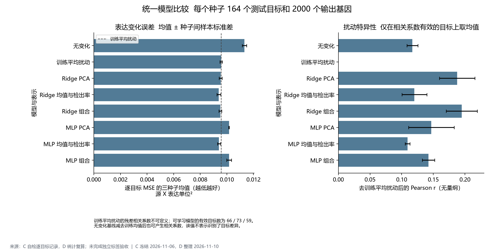
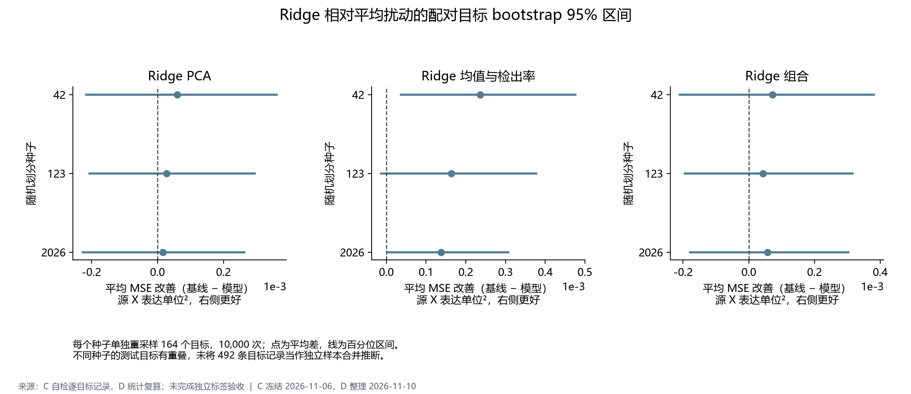
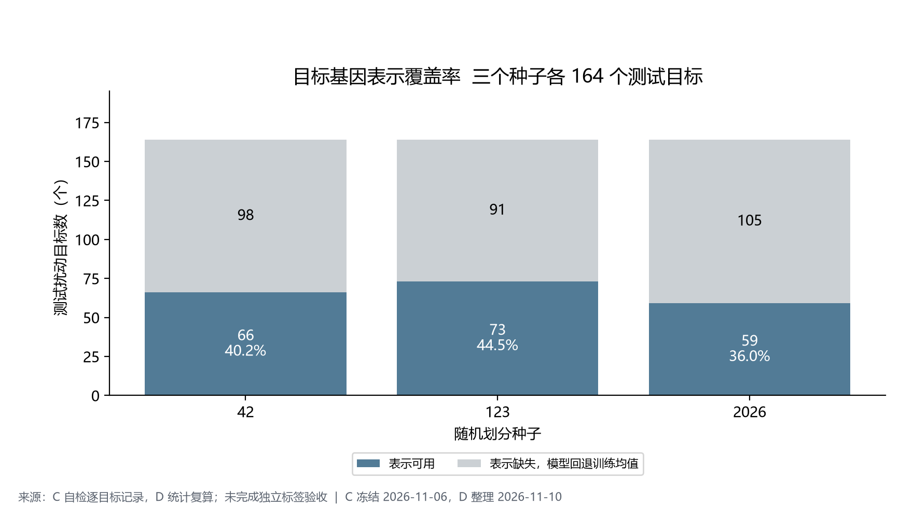
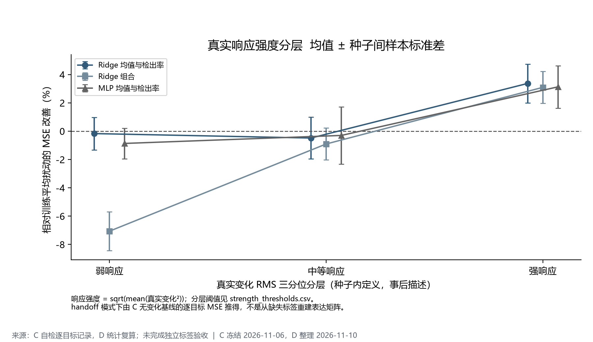
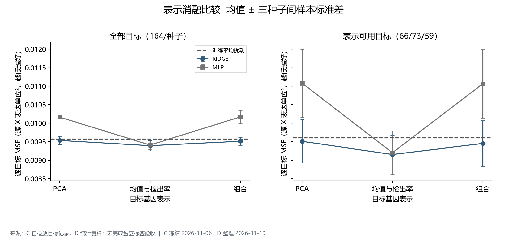

# D 统一评测与结果比较

评测日期：2026-11-10。对象为 K562 CRISPRi 未见目标扰动的群体平均表达变化。

本轮结果来源为**D 对 C 自检逐目标记录的统计复算**。当前文件完整性核验、预测接口核验、指标程序和统计汇总已完成。B 的训练与测试标签、独立划分文件及 A 的参考预测按本轮要求保留为空；未完成基于 B 标签的独立指标验收。

现有结果显示，简单的训练平均扰动已解释相当一部分可预测变化；Ridge 和 MLP 的改进有限。目标表示缺失时的回退占比较高，因此需要同时看总体误差、表示可用子集和去平均扰动后的相关性。

## 1 评测范围与证据

冻结实验为 `c_v1_20261106`，种子为 [42, 123, 2026]。独立核对 255 项 SHA256，检查测试与验证预测的目标和基因顺序、矩阵形状、有限数值、表示掩码、回退值以及声明的目标划分。C 自检逐目标表与种子汇总、跨种子均值和标准差一致。文件哈希一致只能证明交接完整性，不能代替标签真实性和指标重算。

每种子按 760 个训练目标、162 个验证目标和 164 个测试目标进行记录；同一目标未在该种子的训练、验证、测试声明中交叉。每种子输出 2000 个基因，同一种子内所有方法使用完全相同的顺序。输出基因随种子而变，跨种子结果是三套实验的描述性均值。未合并不同种子的重复目标进行独立样本推断。

已纳入无变化、训练平均扰动、Ridge 的三种表示和 MLP 的三种表示，共 8 种方法、24 个测试预测包。A 的 kNN 或 GEARS 未提供，不计作零分，也不据此比较其性能。

## 2 指标和统计口径

- MSE：先在每个目标的输出基因上计算平方误差均值，再对目标等权平均，不按细胞数量加权。
- 平均扰动基线：先得到每个训练扰动的平均变化，再对训练扰动等权平均；本轮仅核对 C 保存的训练均值及对应预测。独立模式会从 B 的训练标签重算并核验。
- Pearson 和 Spearman：逐目标计算；Spearman 对并列数值使用平均秩。常数向量的相关系数为缺失，汇总同时给出有效目标数。
- Top-20：按绝对变化降序、基因 ID 升序处理并列值，交集大小除以 20；方向一致率只在交集内计算，再对有效目标等权平均。全零预测的 Top-20 仅是并列值的确定性选取，其方向指标记缺失。
- 扰动特异性：预测和真实变化都减去同一种子的训练平均扰动，再计算 Pearson 与 Spearman。两者同时减去同一向量不改变 MSE，所以不重复报告等价误差。
- 辅助误差：若被干预目标本身出现在输出基因中，另报告剔除该坐标后的 MSE；当前 gene_ids 为基因符号，按精确 ID 匹配。
- 三种子汇总：对每个种子的宏平均等权求均值，标准差采用样本标准差，ddof=1；它不是目标级误差条或置信区间。
- Bootstrap：每个种子内配对同一扰动目标，10,000 次有放回重采样，给出均值差的百分位 95% 区间。正值表示基线 MSE 减去模型 MSE 后有改善；不同种子不合并。这些比较是描述性分析，未作多重比较显著性宣称。

D 的指标实现不导入 C 的评测代码。handoff 模式只复算统计，指标值仍来自 C；independent 模式才重新读取 B 标签逐目标计算。

## 3 模型比较

以下 MSE 单位为源 X 表达单位的平方，相关系数为无量纲；数值为三种子均值 ± 样本标准差。

- **无变化**：MSE 0.011320 ± 0.000162；变化相关系数不可定义。
- **训练平均扰动**：MSE 0.009572 ± 0.000093；Pearson 0.3846；Spearman 0.3197；Top-20 重合率 16.65%。
- **Ridge PCA**：MSE 0.009536 ± 0.000114；Pearson 0.3917；Spearman 0.3237；Top-20 重合率 18.39%；相对平均扰动 MSE 改善 0.37%。
- **Ridge 均值与检出率**：MSE 0.009392 ± 0.000141；Pearson 0.3933；Spearman 0.3281；Top-20 重合率 16.65%；相对平均扰动 MSE 改善 1.87%。
- **Ridge 组合**：MSE 0.009514 ± 0.000106；Pearson 0.3933；Spearman 0.3249；Top-20 重合率 18.37%；相对平均扰动 MSE 改善 0.60%。
- **MLP PCA**：MSE 0.010163 ± 0.000024；Pearson 0.3756；Spearman 0.3061；Top-20 重合率 17.29%；相对平均扰动 MSE 改善 -6.18%。
- **MLP 均值与检出率**：MSE 0.009410 ± 0.000112；Pearson 0.3919；Spearman 0.3248；Top-20 重合率 16.87%；相对平均扰动 MSE 改善 1.68%。
- **MLP 组合**：MSE 0.010169 ± 0.000183；Pearson 0.3710；Spearman 0.3028；Top-20 重合率 17.00%；相对平均扰动 MSE 改善 -6.24%。

均值与检出率表示下的 Ridge 在总体 MSE 上表现较好；组合表示下的 Ridge 在残差相关性上较好。这说明不同指标考察的内容不同，不能据单一指标宣称某种模型全面最优。

模型选择仍沿用测试前 C 冻结的、各自验证集选出的学习器：seed 42 选择 mlp_mean_detection；seed 123 选择 ridge_mean_detection；seed 2026 选择 mlp_mean_detection。该验证选择流程的测试 MSE 为 0.009420 ± 0.000118，相对训练平均扰动改善 1.58%。固定模型表用于比较，不用测试排名重新选择参数。详细指标见 validation_selected_across_seeds.csv。

## 4 Ridge 配对置信区间

**Ridge 均值与检出率** 相对训练平均扰动的 MSE 差值：

- seed 42：改善 0.000236，95% CI [0.000036, 0.000476]，区间在 0 的同一侧。
- seed 123：改善 0.000164，95% CI [-0.000013, 0.000378]，区间跨 0。
- seed 2026：改善 0.000138，95% CI [0.000005, 0.000307]，区间在 0 的同一侧。

**Ridge PCA** 相对训练平均扰动的 MSE 差值：

- seed 42：改善 0.000060，95% CI [-0.000216, 0.000361]，区间跨 0。
- seed 123：改善 0.000028，95% CI [-0.000205, 0.000295]，区间跨 0。
- seed 2026：改善 0.000017，95% CI [-0.000227, 0.000263]，区间跨 0。

**Ridge 组合** 相对训练平均扰动的 MSE 差值：

- seed 42：改善 0.000072，95% CI [-0.000209, 0.000381]，区间跨 0。
- seed 123：改善 0.000043，95% CI [-0.000195, 0.000316]，区间跨 0。
- seed 2026：改善 0.000057，95% CI [-0.000179, 0.000303]，区间跨 0。

上述区间反映给定划分中目标抽样的不确定性；没有覆盖完整训练重运行、表达测量、不同细胞系和不同数据集的不确定性。

## 5 表示覆盖与响应强度分层

- seed 42：表示可用 66/164（40.24%），缺失 98 个；六种可学习模型对缺失目标都严格回退至该种子的训练平均扰动。
- seed 123：表示可用 73/164（44.51%），缺失 91 个；六种可学习模型对缺失目标都严格回退至该种子的训练平均扰动。
- seed 2026：表示可用 59/164（35.98%），缺失 105 个；六种可学习模型对缺失目标都严格回退至该种子的训练平均扰动。

模型在缺失子集与平均扰动基线的预测完全相同，所以该子集的 MSE 改善严格为 0。残差相关性在这些回退目标上不可定义；可学习模型的残差相关有效目标数为各自可用目标数，而训练均值基线为 0。有效样本的变化必须与相关性数值一起阅读。

响应强度定义为真实变化向量的 RMS，并按每种子内的 1/3 和 2/3 分位数划为弱、中、强响应。本轮 handoff 模式由 C 无变化基线逐目标 MSE 的平方根获得该强度，未据此重建真实表达矩阵。阈值、样本量、各层全部方法的误差和相关性均保存在结果表中；这种分层属于测试结果的事后描述，不用于重新调参。

## 6 表示消融与解释边界

PCA、均值与检出率、组合表示分别比较，保持同种子的目标、输出基因和评测口径一致。当前记录中，加入 PCA 的 MLP 总体 MSE 没有优于仅均值与检出率；Ridge 的组合表示提高残差相关性，但未同时取得最低总体 MSE。该比较反映本轮固定模型和表示，不证明 PCA 或非线性方法普遍无效。

C 的运行元数据显示：源 X 的归一化与 log1p 状态未核实；上游 5000 基因已预选，选择过程的泄漏状态不明；缺少 guide 和 batch 字段，使用划分内混合对照。以上约束影响对表达单位、批次匹配和外部泛化的解释，本报告不将这些元数据声明视为 D 已完成的数据审计。MLP 本轮固定 dropout 和 weight decay，仅选择隐藏维度、学习率与早停轮次。

## 7 交给 E 的案例与数据

E_handoff 内包含每种子固定散列抽取的 3 个表示可用目标和 3 个缺失目标，使用各自验证集选出的模型。选择规则可复现，但制定时已有上游测试汇总可见，因此明确标注为事后展示案例，而非测试前预注册。case_metrics.csv 给出误差、相关性和相对基线改善；cases_seed_*.npz 含预测矩阵、目标顺序、基因顺序及训练均值。真实变化矩阵保持缺失，NPZ 中没有 delta_true 键；Top-20 预测表的 delta_true 留空，不能据此生成真假散点图或真实通路富集。

posthoc_best_worst.csv 另列表示可用目标中按误差改善排序的较好与较差案例，仅用于探索性讨论。B 的细胞数量和注释未提供，本轮不进行细胞数与误差的关系分析；也不在缺少独立真值时给出 DEG 检验或校准指标。

## 8 交付与复现

主入口为 scripts/run_d_evaluation.py；指标与统计在 src/evaluation；自动检查在 tests/test_d_evaluation.py。docs/d_evaluation.md 提供运行方式、缺项处理、后续独立模式和 A 预测接口。manifest.json 记录命令、环境、源文件及产物哈希。

结果表包含逐目标记录、每种子与跨种子汇总、有效指标数量、表示覆盖、响应强度分层、配对 bootstrap 和验证选择流程结果。A 与 B 的待补项在 pending_inputs.json 中保持 null，不作为模型得分。所有图均由本轮结果表生成，SVG 可编辑、PNG 可直接用于汇报。
